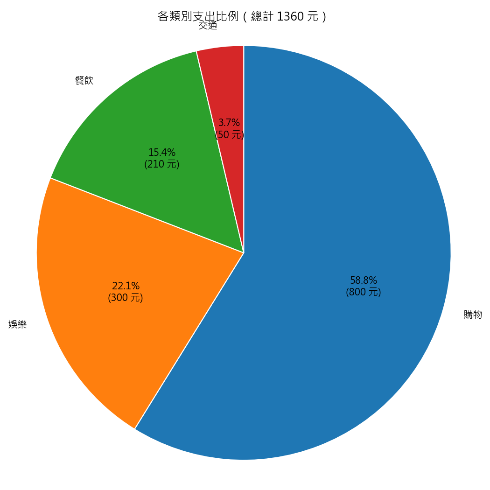

# 記帳小工具 Expense Tracker

Introduction to Software Engineering — Assignment 1（Version Control Practice）

用 Python 寫的簡易記帳工具：可以輸入每筆支出，並依「類別」畫出圓餅圖，看出錢都花到哪裡。

## 組員與分工

| 成員 | 負責模組 | 檔案 | 分支 |
|---|---|---|---|
| wiichen1103 | 輸入模組：新增支出並存檔 | `expense_input.py` | `feature-input` |
| Peng818 | 視覺化模組：依類別畫圓餅圖 | `piechart.py` | `feature-piechart` |

## 環境需求

- Python 3.8 以上
- matplotlib

## 安裝

```bash
git clone https://github.com/wiichen1103/expense-tracker.git
cd expense-tracker
pip install matplotlib
```

## 使用方式

### 1. 輸入支出

```bash
python expense_input.py
```

執行後會出現選單：

- `1` 新增支出：依序輸入日期、金額、類別、備註
  - 日期格式為 `YYYY-MM-DD`，直接按 Enter 代表今天
  - 金額必須是大於 0 的數字
  - 類別可輸入編號（餐飲、交通、購物、娛樂、住宿、其他），也可以直接打新的類別名稱
  - 備註可留空
- `2` 查看所有紀錄與總金額
- `0` 離開

資料會存到同一個資料夾的 `expenses.csv`。

### 2. 產生圓餅圖

```bash
python piechart.py
```

程式會讀取 `expenses.csv`，依類別加總金額，跳出圓餅圖視窗，並同時存成 `pie_chart.png`。

## 資料格式

`expenses.csv` 為 UTF-8 編碼的 CSV 檔，欄位如下：

```
date,amount,category,note
2026-11-25,120.0,餐飲,午餐
2026-11-25,50.0,交通,捷運
```

## 範例圓餅圖



## 專案結構

```
expense-tracker/
├── expense_input.py   # 輸入模組
├── piechart.py        # 圓餅圖模組
├── expenses.csv       # 支出資料
├── pie_chart.png      # 範例圓餅圖
└── README.md
```

## Git 協作流程

1. 兩位成員各自在自己的分支開發：`feature-input`、`feature-piechart`
2. 各自 commit 並 push 到 GitHub
3. 用指令 `git fetch` 取得對方分支，再以 `git merge --no-ff` 合併進 `main`，讓 Network Graph 清楚顯示分支合併